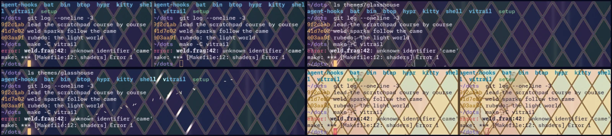

<!-- SPDX-FileCopyrightText: 2026 fuddlesworth -->
<!-- SPDX-License-Identifier: GPL-3.0-or-later -->

# Glasshouse for Afterglow

This example adapts Afterglow's appearance to [Glasshouse](https://github.com/Dsaquel/dots), Dsaquel's stained-glass Hyprland desktop.
It uses stained-glass backgrounds, illuminated lead borders and an overhead lamp.
The dark palette adds light. The light palette uses darker marks.
Vitrail supplies the window frame.



## Components

| Component | Location | Behavior |
| --- | --- | --- |
| `glasshouse-glass` | Background | Stained-glass pattern illuminated by the lamp. |
| `glasshouse-gilt` | Text | Lamp glow and periodic light movement behind letters. |
| `glasshouse-ember` | Cursor | Cursor glow and sparks during movement. |
| `glasshouse-mullion` | Pane | Lead dividers and moving focus highlights. |
| `glasshouse.luau` | Script | Converts shell events into shader signals. |

Text has a separate layer. Glass does not blur or tint it.
Shell integration uses OSC 133.

| Event | Effect |
| --- | --- |
| Command failure | Cracks spread from the prompt, glow, cool and disappear after a few seconds. Ctrl+C is excluded. |
| Success after at least 5 seconds, or OSC 7501 task completion | Light moves along the borders and text. |
| Running command | Lamp and borders become warmer. They cool after completion. |
| Bell | A ring expands from the cursor and distorts the glass. |
| OSC 7501 working status | Lamp intensity changes periodically. |
| OSC 7501 blocked or error status | Glass uses the alert color. |
| Command completion after at least 20 seconds in an unfocused pane | Desktop notification. |

The command palette includes Glasshouse strike, glaze, ring and heat actions.
Bind an action with configuration such as:

```json
{"Keybinds": {"bindings": {"script:glasshouse.strike": "Ctrl+Alt+S"}}}
```

`afterglow ctl signal 0 1` triggers strike in the focused pane.

## Install

Run from this example directory:

```sh
bin/glasshouse-afterglow install
```

The command copies shaders and the script into `~/.config/afterglow`.
It merges font, padding, shader and dark-palette settings into `config.json`.
Other settings remain unchanged. Running windows reload the changes.

## Follow palette changes

Shaders read the palette from the terminal background.
Change the colors with:

```sh
bin/glasshouse-afterglow world dark    # or light
```

Add Afterglow's configuration to the files saved by Glasshouse `theme-switch.sh` before a change.
This permits rollback after failure:

```bash
MUTABLE=(
    ...
    "${HOME}/.config/afterglow/config.json"
)
```

Add the Afterglow switch beside the Kitty theme switch:

```bash
put "${TMP_KITTY}" "${KITTY_DIR}/theme-active.conf"
glasshouse-afterglow world "${MODE}"
```

## Signals

Shaders read `uSignal` values through `signalValue` and `signalAge`.
Scripts use `afterglow.signal(pane, channel, value)`.
Other programs use `afterglow ctl signal CHANNEL VALUE` or D-Bus `Signal`.

| Channel | Name | Value |
| --- | --- | --- |
| 0 | strike | Exit code. |
| 1 | glaze | Command duration in seconds. |
| 2 | heat | 1 during a command; 0 after completion. |
| 3 | ring | Any value. |
| 4 | status | 1 working, 2 blocked, 3 error, 0 none. |

## Credits

Glasshouse, its palettes and its appearance are Dsaquel's work: [Dsaquel/dots](https://github.com/Dsaquel/dots).
These shaders and scripts were written for Afterglow. They do not copy Glasshouse code.
