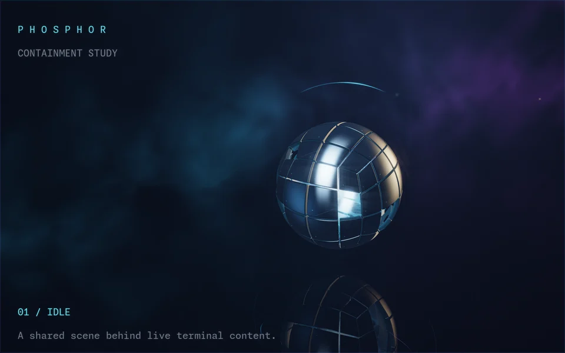

<!-- SPDX-FileCopyrightText: 2026 fuddlesworth -->
<!-- SPDX-License-Identifier: GPL-3.0-or-later -->

# Phosphor for Afterglow

This scene places a shared 3D reactor inside a lit chamber.
It includes curved metal fragments, plasma, magnetic filaments, haze and reflections.
System playback controls armor, plasma and lights.
Shell events charge and fracture the reactor. Pressure waves distort live terminal content.



## Try it

From a built checkout, run:

```sh
data/examples/phosphor/bin/phosphor-afterglow launch --show --binary ./build/afterglow/afterglow
```

Add `--mesh` to use the triangle-mesh reactor with the same Luau actions:

```sh
data/examples/phosphor/bin/phosphor-afterglow launch --mesh --show --binary ./build/afterglow/afterglow
```

This mode adds segmented armor, plasma, orbiting emitters and a lit floor.
The default scene uses ray marching.

After installation, run:

```sh
/usr/share/afterglow/examples/phosphor/bin/phosphor-afterglow launch --show
```

Adjust the path for an installation prefix other than `/usr`.
Requirements are Python 3, Bash, Wayland, Vulkan and the current Afterglow shader and Luau APIs.
Required interfaces include the terminal shader contract with `terminal_history.glsl`, `terminal_audio.glsl`, `highDynamicRange` and `uScrollback`, version 1 snapshots, parameter transitions and presets.
Install `cava` for audio response.
Add `--light` to start with the light palette.

The launcher creates temporary configuration, shader packs and scripts, then starts a separate Afterglow process.
Closing its last window removes the temporary configuration.
Normal Afterglow settings remain unchanged.
Each split opens a clean Bash demo shell with OSC 133 integration.
Programs inside it use your normal XDG configuration directory.
The demo shell does not save history.

## Demonstration commands

```sh
phosphor show
phosphor scene light
phosphor scene dark
```

`--show` starts the demonstration in the first pane. `phosphor show` repeats it.
The stages are idle, charge, fracture, recall, shock front and afterglow.
The sequence uses the alternate screen. Completion or Ctrl+C restores the prompt.
OSC 1337 user variables trigger real Luau actions.
Ordinary commands charge the core. Failure fractures it. A success of 1.5 seconds or longer recalls its pieces.

## Scene controls

Select **Edit scene parameters and presets** in the command palette.
Select `background: phosphor-field` to apply Quiet, Balanced or Cinematic.
The editor also changes parameters, saves current values and resets its overrides.
Demo presets exist only until the temporary directory is removed.
Install [scene-controls](../packages/scene-controls/README.md) in normal configuration for persistent presets.

**Toggle contextual Phosphor exposure** enables one intensity decision each second from audio and history summaries.
The host interpolates changes. Disable this option to release its overrides.
Audio and history continue to affect the shader directly.
Command activity uses host transitions. Fracture, recall and shock fronts use signal timestamps.

See [measurements](PERFORMANCE.md) before choosing a preset for 4K.
Quality tiers specify sampling quality, not guaranteed frame rates.
The text effect adds a dark glyph outline for readability over highlights.
`phosphor-emission.readability` controls this outline from 0 to 1. Its default is 0.9.

## Audio response

Play audio in your normal player or browser.
PhosphorAudio and CAVA analyze system playback, as in PlasmaZones.

| Input | Effect |
| --- | --- |
| Bass | Opens armor, increases plasma energy and strengthens floor caustics. |
| Mids | Bend and illuminate filaments and haze. |
| Treble | Illuminates floating particles. |
| Individual bands | Illuminate panel indicators and orbital segments. |

Audio and Luau operate together.
Command failure fractures the core. Success recalls it. Bells send shock fronts.
Silence preserves normal scene animation.
The lens adds bloom before text composition.

`Shaders.params.phosphor-field.audioStrength` ranges from 0 to 2. Its default is 1.
Set `Audio.enabled` to `false` to stop capture.
`Audio.inputMethod` and `Audio.inputSource` select the backend and source. Both default to `auto`.
Capture stops when no exposed audio-responsive window remains.
Missing CAVA logs a warning. The scene continues to run.

## Scrollback response

Combined retained history in the current tab increases the scene's baseline energy.
Effects include brighter plasma, more open armor, stronger violet light, illuminated filaments, haze and floor caustics.
Background tabs and other windows do not contribute.
Audio and Luau continue to apply their effects.

1. Run `seq 1 4000` in a demo pane.
2. Switch to a fresh tab.
3. Return to the original tab.

The fresh tab reduces baseline energy. Returning restores the original history contribution.
Clearing history or closing a pane lowers the total.
Full-screen programs preserve primary-screen history influence.

`Shaders.params.phosphor-field.historyStrength` ranges from 0 to 2. Its default is 1. Zero disables the influence.
`historyScale` sets the growth rate. The default is 4000 rows.
At this setting, 4000 combined rows produce approximately 63 percent influence. 10000 rows produce 92 percent.
The influence approaches its maximum smoothly.
Growth and decay use the renderer's smoothed count.

## Make a clip

1. Open the demo.
2. Enlarge the window.
3. Press **Ctrl+Shift+E** to split right.
4. Press **Ctrl+Shift+O** to split the focused pane down.
5. Move the pointer over the window to change depth.
6. Drag a divider to show different parts of the scene.
7. Start music.
8. Run `phosphor show` in one pane.

The core uses one camera across the window. The scene remains stationary while dividers move.
Quiet prompts in other panes make light and afterimages easier to see.
The final view can show the reassembled core and the Afterglow desktop icon.

The command palette (**Ctrl+Shift+P**) also contains these actions:

| Shortcut | Action | Signal |
| --- | --- | --- |
| Ctrl+Alt+1 | Phosphor: fracture the core | 0 |
| Ctrl+Alt+2 | Phosphor: recall the fragments | 1 |
| Ctrl+Alt+3 | Phosphor: send a shock front | 3 |
| Ctrl+Alt+4 | Phosphor: charge the core | 2 |

The charge lasts until the next command completes.

Use the palette if desktop shortcuts intercept these keys.
The demo process never owns the `afterglow ctl` service name.
Use the palette or the shortcuts.

## Layers and signals

| Pack | Chain | Behavior |
| --- | --- | --- |
| `phosphor-field` | background | Curved shell panels, studio lighting, plasma volume, filaments, orbital traces, particles, haze, caustics and floor reflections. The plasma uses 48 steps. |
| `phosphor-lens` | background, after field | Three-scale HDR bloom, anamorphic scatter, filmic highlight compression, vignette and dithering. Runs before text composition. |
| `phosphor-emission` | text | Colored glyph halos and retained afterimages. Current glyphs preserve color and position. |
| `phosphor-cursor` | cursor | Tapered filaments during cursor movement. |
| `phosphor-frame` | pane | Frame light, refractive shock fronts, trailing ripples and a narrow color fringe. |

The script reads `ev.terminal` snapshots and updates the event's tab with `afterglow.signals`.
Each batch uses one timestamp across panes.
It also works when loaded after panes exist. No separate pane registry is required.
One completed command does not cool the core while another pane in that tab is running a command.
Background tabs and other windows retain separate state.
Each signal stores a value and its shader update time.

| Channel | Meaning |
| --- | --- |
| 0 | Failed command exit code. Ctrl+C and unknown codes are ignored. Also 1 for program status `error`. |
| 1 | Successful command duration in seconds, for commands lasting at least 1.5 seconds. Also used for program status `done`. |
| 2 | 1 during a command. 0 after completion. |
| 3 | Bell event. |
| 4 | Program status: 1 working, 2 blocked, 3 error, 0 otherwise. |

## Rendering and memory

Text history uses one window-sized texture of the previous processed text layer.
Decay uses elapsed frame time.
Shader reload, layout, tab, size, default colors, font cell size and clock reset clear history.
History is allocated and copied only when a shader includes `terminal_history.glsl`.
The plain renderer does not require it.

Field and lens request RGBA16F intermediate targets with `"highDynamicRange": true` in their metadata.
Highlights remain above display white until lens bloom and tone mapping.
Display output remains SDR.
The history texture requires approximately 16 MiB at 1080p or 64 MiB at 4K, in addition to layer targets.
Chains without this setting use RGBA8 at half that memory cost.

The scene combines analytic ray intersections, rounded signed-distance surfaces and volume integration.
Glyphs, selection and input remain on the flat terminal surface.
The renderer controls history and layer separation independently of the compositor.
Palette changes reload immediately without a color transition.

## Tuning

Each pack declares parameters in `metadata.json`.
Add overrides under `Shaders.params` in `config/phosphor.json` before launch:

```json
{
    "Shaders": {
        "params": {
            "phosphor-field": { "intensity": 0.85, "speed": 0.4, "parallax": 0.25, "quality": 1, "audioStrength": 1, "historyStrength": 1, "historyScale": 4000 },
            "phosphor-lens": { "bloom": 0.45, "streak": 0.12 },
            "phosphor-emission": { "persistence": 0.08, "glow": 0.18 },
            "phosphor-cursor": { "wake": 0.2 }
        }
    }
}
```

The shell contains 96 curved panels. Omitted panels expose the core.
Bounding spheres reject panels before surface ray marching.

| Quality | Samples per pixel |
| --- | --- |
| 0 | One. |
| 1 | Two rotated-grid samples. This is the default. |
| 2 | Four samples for capture. |

`shutter` controls motion integration across samples.
Text retains normal sharp rendering.
The scene animates continuously and traces reflected and primary views.
Cost increases with resolution and sample count.
Use quality 0 to reduce capture cost. Lens and atmosphere effects remain active.

Remove both `phosphor-field` and `phosphor-lens` from the background chain to disable the scene background.
Zero `speed` and `parallax` freeze the camera without stopping redraws from animated packs.
Clear all shader chains for reduced motion.

## Render an animation without desktop capture

The developer renderer accepts `--frames N --fps N`.
With multiple frames, `shot.png` becomes `shot-0000.png`, `shot-0001.png` and subsequent numbered files.
Shader time and signal ages advance at the requested playback rate, independently of render speed.
The renderer finds packs in the shader search path. The Phosphor packs are not in it.
Copy the packs, including `shared/`, into a separate configuration directory, and set `XDG_CONFIG_HOME` to it:

```sh
mkdir -p /tmp/phosphor-render/afterglow/shaders
cp -r data/examples/phosphor/shaders/* /tmp/phosphor-render/afterglow/shaders/
XDG_CONFIG_HOME=/tmp/phosphor-render afterglow_renderpng --background-shader phosphor-field \
    --background-shader phosphor-lens --dpr 2 --time 10 \
    --signal 0=1@0 --frames 48 --fps 24 input.ansi fracture.png
ffmpeg -framerate 24 -i fracture-%04d.png -c:v libx264 -pix_fmt yuv420p fracture.mp4
```

The preview uses the actual renderer.
`--timings --frames N` separates render/readback time from PNG encoding.
These measurements include readback. They are not GPU-only timings.

`--audio-bands 0.7,0.3,0.15` supplies synthetic bass, mid and treble levels for deterministic previews.
Without this option, the renderer uses silence.
The interactive launcher uses system playback automatically.

`--scrollback-lines 10000` supplies synthetic combined history.
Without this option, the renderer sums actual retained rows from the supplied panes.

Command activity uses `commandHeat` and a 650 ms host transition.
Fracture, recall and shock fronts use signal timestamps.
Install the shader pack and script together.
